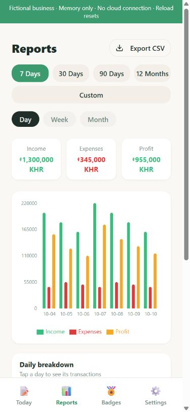
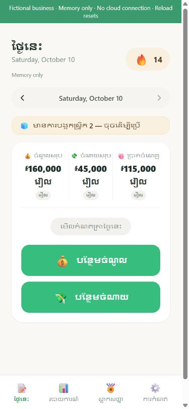

# Fictional Ledger

**Mini showcase — NOT the actual Khmer Cash Flow app.** Fictional Ledger is a small, disconnected extract of selected workflows from the larger shared Cambodian business product (called Khmer Coin Keeper in its source). The public demo is not the full original application.

I did most of the original app’s AI-assisted development. The original includes account handling, queued cloud writes, account-switch safeguards and operational integrations; those are excluded from this mini showcase. Here, visitors can try only fictional ledger entry, reports, currency display and habit feedback in English or Khmer. [Explore the original product and my role](CASE_STUDY.md).

[Try the fictional demo](https://cameronjohnboyle2-hub.github.io/fictional-ledger-showcase/) · [Product case study](CASE_STUDY.md)

This public showcase adapts selected UI and ledger source from the shared Khmer Coin Keeper project. I contributed most of the AI-assisted development; Ben owns the Lovable workspace. It is AI-assisted development on a shared application, not a claim of sole authorship or conventional hand coding. See [credits and rights](CREDITS_AND_RIGHTS.md).

## Two-minute walkthrough

1. Open Today. Fourteen days of invented transactions are ready; today's initial income/expenses are 160,000/45,000 KHR.
2. Add an invented income or expense; tap today's log to edit or delete a row.
3. Open Reports, change grouping between day/week/month, and inspect the daily breakdown.
4. Export CSV. This downloads the complete current fictional ledger, regardless of the selected report range. Text cells are quoted and formula-like text is neutralized.
5. In Settings, switch English/Khmer or KHR/USD. The fixed demonstration rate is 4,000 KHR per USD; it is not a current market quote. Reload or reset to discard all changes.

The demo has no account, PIN, Supabase SDK, production endpoint, administrator/recovery/export service, research integration, native notification or model service. Browser storage is replaced with a fresh memory store before app modules load. Failure to establish that boundary prevents application loading. The backend facade returns no session or data and denies query/write/function operations. Content policy forbids network connections. Do not enter real financial or personal information.

## Run locally

Use Node.js 22.13 or later and npm:

```sh
npm ci --ignore-scripts
npm test
npm run typecheck
npm run build
npm run preview
```

The preview binds to localhost. No credentials or environment file is required. Build output uses relative paths and hash routing. Serve only `dist/`. GitHub Actions installs the lockfile with package scripts disabled, runs the ten tests and TypeScript, builds, then deploys only this static directory. Dependency and UI notices are included in `NOTICES.txt`. Development tooling is not part of the hosted build.

## Stack and design

React 18, TypeScript, Vite 8, Tailwind 4, React Router 7, i18next, Radix UI and Recharts. The extract removes unused integrations and the legacy XLSX dependency; CSV is the adapted showcase export. [Architecture](ARCHITECTURE.md), [product case study](CASE_STUDY.md), [verification](VERIFICATION.md), and [dependency notices](THIRD_PARTY_NOTICES.md) explain the boundaries.

## Evidence and limits

A fresh copy passes installation from the lockfile, ten behavior/isolation tests, TypeScript and production build. Refreshed installation reports zero audit findings at the review point, not a permanent security guarantee. Browser checks cover English/Khmer ledger navigation, mutations/totals, display conversion, charts/grouping, reset and a real fictional CSV file. The 390-by-844 ledger view has no page horizontal overflow. This is not a test of the original live app, native devices, cloud synchronization or production security. Dates can follow browser locale availability; some new showcase-specific text remains English. The build reports a large application chunk; no load-time claim is made.

I approved publication of this fictional copy. The original source and production app remain unchanged. This release preserves shared-development credits and third-party notices; it grants no general reuse license to the shared application source. Historical adoption figures remain reported estimates, with definitions and dates still to confirm.

## Screenshots from the fictional copy




